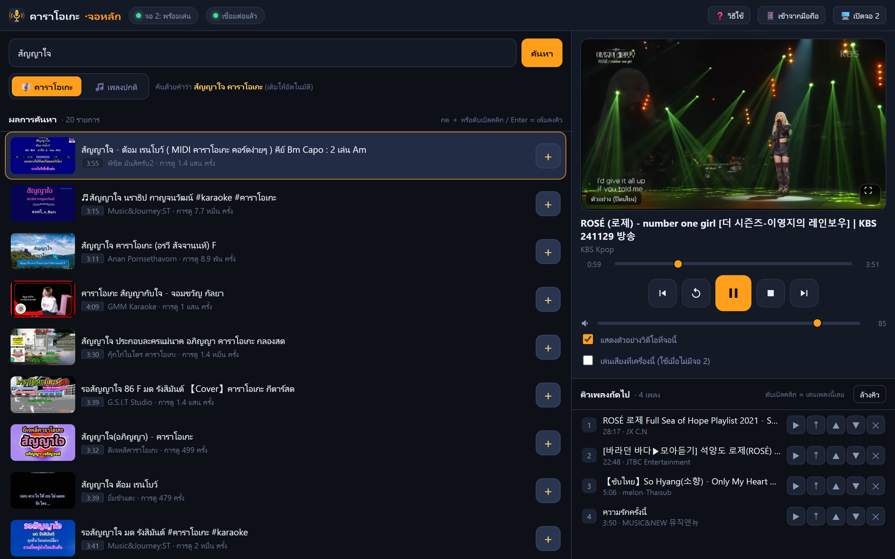
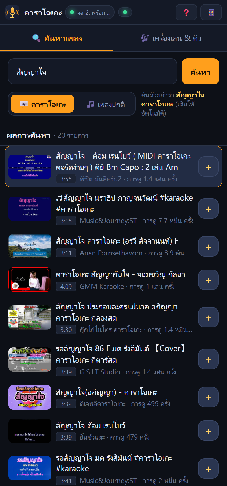

# 🎤 ระบบร้องคาราโอเกะ

โปรแกรมคาราโอเกะสำหรับที่บ้าน ร้าน หรืองานเลี้ยง — ค้นเพลงจาก YouTube เล่นออกจอใหญ่
แล้วให้ทุกคนในงานหยิบมือถือขึ้นมาจิ้มเพลงเข้าคิวเองได้ ไม่ต้องเดินมาที่คอม

**[⬇️ ดาวน์โหลดเวอร์ชันล่าสุด](../../releases/latest)** · ไฟล์เดียวจบ ไม่ต้องติดตั้ง ไม่ต้องสมัครอะไร ใช้ฟรี

## ทำอะไรได้บ้าง

- **ค้นเพลงจาก YouTube** พิมพ์ชื่อเพลงแล้วกด Enter ระบบเติมคำว่า "คาราโอเกะ" ให้เอง จะได้เจอแต่คลิปที่ร้องตามได้ (สลับเป็นเพลงปกติได้)
- **แยกจอ** จอคอมเป็นแผงควบคุม ส่วนทีวี/โปรเจกเตอร์เป็นจอ 2 แสดงเฉพาะวิดีโอเต็มจอ ไม่มีปุ่มอะไรมากวน
- **สั่งจากมือถือ** ทุกคนในวง Wi-Fi เดียวกันสแกน QR แล้วเพิ่มเพลงเข้าคิวได้เลย รองรับพร้อมกันหลายสิบเครื่อง
- **คิวเป็นระเบียบ** เพิ่มทีหลังเล่นทีหลัง ไม่มีแซงคิว ถ้าอยากให้เพลงไหนขึ้นก่อนก็ดับเบิลคลิกที่เพลงนั้น
- **เตือนเพลงซ้ำ** ถ้ามีคนใส่เพลงที่มีอยู่แล้ว ระบบจะบอกว่าอยู่คิวที่เท่าไหร่ แล้วถามก่อนว่าจะใส่เพิ่มไหม
- **คิวไม่หาย** ปิดโปรแกรมแล้วเปิดใหม่ คิวเดิมยังอยู่ครบ
- **คลิปที่ฝังไม่ได้ก็เล่นได้** บางคลิปเจ้าของห้ามเอาไปฝังในเว็บอื่น ระบบจะสลับไปเปิดบน YouTube เต็มจอให้เอง ปิดซับ ข้ามโฆษณา แล้วพอเพลงจบก็กลับมาเล่นคิวถัดไปตามปกติ

## เริ่มใช้งาน

1. โหลดไฟล์ `Karaoke.exe` จาก [หน้าดาวน์โหลด](../../releases/latest)
2. ดับเบิลคลิกเปิดได้เลย จะมีหน้าต่างดำขึ้นมาพร้อมหน้าจอหลัก
3. ครั้งแรก Windows Firewall จะถามว่าจะอนุญาตไหม ให้ติ๊ก **เครือข่ายส่วนตัว** แล้วกดอนุญาต (ไม่ติ๊กมือถือจะเข้าไม่ได้)
4. กดปุ่ม **เปิดจอ 2** เพื่อส่งภาพไปทีวี/โปรเจกเตอร์
5. กดปุ่ม **เข้าจากมือถือ** เพื่อโชว์ QR ให้เพื่อนสแกน

> **Windows ขึ้นจอฟ้าว่า "Windows protected your PC"**
> เป็นเรื่องปกติของโปรแกรมเล็ก ๆ ที่ไม่ได้ซื้อใบรับรองราคาแพงมาเซ็นกำกับ
> กด **More info** แล้วกด **Run anyway** ก็ใช้ได้ตามปกติ

## ต้องมีอะไรบ้าง

| | |
|---|---|
| ระบบปฏิบัติการ | Windows 10 / 11 |
| เบราว์เซอร์ | Chrome หรือ Edge (Windows มี Edge ติดมาให้อยู่แล้ว) |
| อินเทอร์เน็ต | ต้องมี เพราะเพลงมาจาก YouTube |
| มือถือ | ต่อ Wi-Fi วงเดียวกับคอม |

ไม่ต้องลง Python ไม่ต้องขอ API key ไม่ต้องสมัครสมาชิก

## คำถามที่เจอบ่อย

**ปิดโปรแกรมยังไง**
ปิดหน้าต่างดำ หน้าต่างอื่นของโปรแกรมจะปิดตามให้เองทั้งหมด (แท็บงานอื่นใน Chrome ของคุณไม่โดนแตะ)

**มือถือเข้าไม่ได้**
เช็คว่าต่อ Wi-Fi วงเดียวกันจริงไหม แล้วดูว่าตอนเปิดโปรแกรมครั้งแรกได้กดอนุญาต Firewall แบบเครือข่ายส่วนตัวหรือเปล่า

**เพลงบางเพลงขึ้นว่าเล่นไม่ได้**
ระบบจะสลับไปเปิดบน YouTube ให้เองอัตโนมัติ รอสักครู่

**โปรแกรมเก็บไฟล์ไว้ที่ไหน**
ตั้งค่ากับคิวเพลงอยู่ที่ `%LOCALAPPDATA%\Karaoke` ตัว `.exe` จึงอยู่เป็นไฟล์เดียวโดด ๆ ไม่มีไฟล์งอกข้าง ๆ

---

โปรแกรมนี้เป็นเครื่องมือช่วยเปิดคลิปจาก YouTube ไม่ได้เก็บหรือแจกจ่ายไฟล์เพลง
และไม่มีส่วนเกี่ยวข้องกับ YouTube หรือ Google

สงวนลิขสิทธิ์ · แจกให้ใช้ฟรี ไม่อนุญาตให้นำไปขายต่อ
